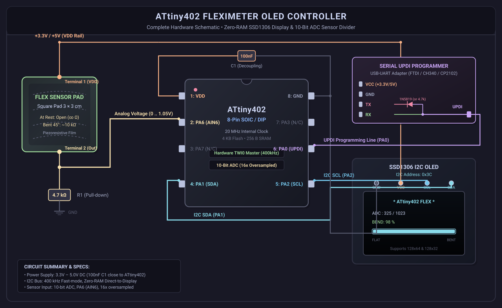

# ATtiny402 Fleximeter OLED Monitor (`attiny_402_flexi`)

[](https://platformio.org/)
[](https://www.microchip.com/wwwproducts/en/ATTINY402)
[](https://github.com/SpenceKonde/megaTinyCore)
[-brightgreen.svg)]()
[-success.svg)]()
[](LICENSE)

An ultra-optimized, zero-external-library bare-metal embedded project driving an **I2C SSD1306 OLED display** (128x64 or 128x32) from an **8-pin ATtiny402 microcontroller** while sampling a 3×3 cm fleximeter pad sensor using the internal 10-bit hardware ADC.

---

## 📸 Hardware Schematic



> Vector format available at [`schematics/attiny402_flexi_schematic.svg`](schematics/attiny402_flexi_schematic.svg).

---

## 🎯 The Architectural Challenge

The **Microchip ATtiny402** (megaAVR 0-series) is an 8-pin microcontroller with extreme hardware constraints:
- **Flash ROM:** 4,096 bytes (4 KB)
- **SRAM:** 256 bytes
- **Package:** 8-pin SOIC

### Why Standard Libraries Fail
1. **No Framebuffer Fits in RAM:** A standard Adafruit GFX / U8g2 128x64 buffer alone requires **1,024 bytes of SRAM**—which is **4× the total 256-byte RAM capacity of the ATtiny402**.
2. **Wire Library Overhead:** Instantiating Arduino `Wire.h` pulls in multiple 32-byte ring buffers, interrupt tables, and C++ class objects, consuming >100 bytes of RAM and >1.5 KB of Flash.

### The Hyper-Optimized Solution
- **Zero-RAM Framebuffer:** Real-time direct-to-display streaming. Text characters, digits, and dynamic progress bar glyphs are streamed directly into the SSD1306 internal GDDRAM via page-addressing mode.
- **Hardware TWI0 Register Driver:** Direct hardware register manipulation of `TWI0.MADDR`, `TWI0.MDATA`, `TWI0.MBAUD`, and `TWI0.MSTATUS` operating in **Fast-mode (400 kHz)** with zero buffer allocations.
- **PROGMEM 5×7 ASCII Font:** 95 printable characters (ASCII 32..126) requiring only 475 bytes of Flash.
- **Direct Hardware ADC:** 10-bit analog conversion with VDD reference, digital input buffer disabled on PA6 to eliminate noise and switching leakage, plus 16× oversampling for noise rejection.
- **Zero-RAM Horizontal Gauge:** Procedurally rendered bar gauge with rounded end caps and dynamic fill.

### 📊 Resource Footprint

| Metric | Used | Available | Percentage |
|:---|:---:|:---:|:---:|
| **SRAM** | **10 Bytes** | 256 Bytes | **3.9%** (246 B free!) |
| **Flash (128x64)** | **1,822 Bytes** | 4,096 Bytes | **44.5%** (>2.2 KB free) |
| **Flash (128x32)** | **1,764 Bytes** | 4,096 Bytes | **43.1%** (>2.3 KB free) |

---

## 🔌 Pinout & Hardware Connections

### ATtiny402 Pinout (8-Pin SOIC / DIP)
```
                  ┌─────∪─────┐
           VDD  ──┤ 1       8 ├──  GND
(AIN6)     PA6  ──┤ 2       7 ├──  PA3
(N/C)      PA7  ──┤ 3       6 ├──  PA0  (UPDI / RESET)
(TWI0 SDA) PA1  ──┤ 4       5 ├──  PA2  (TWI0 SCL)
                  └───────────┘
```

### Wiring Table

| Pin | Symbol | Function | Connected To | Notes |
|:---:|:---:|:---|:---|:---|
| **1** | `VDD` | Power (+3.3V – 5V) | Power Rail / Programmer VCC / Sensor T1 / OLED VCC | Decouple with 100nF C1 to GND |
| **2** | `PA6` | ADC `AIN6` | Flex Pad Terminal 2 & $4.7\text{ k}\Omega$ Resistor | Analog input (0 to ~1.05V) |
| **3** | `PA7` | GPIO | *Unused / Expansion* | Free for LED / Buzzer |
| **4** | `PA1` | TWI0 `SDA` | SSD1306 `SDA` Pin | Internal pull-up enabled in firmware |
| **5** | `PA2` | TWI0 `SCL` | SSD1306 `SCL` Pin | Internal pull-up enabled in firmware |
| **6** | `PA0` | `UPDI` / Reset | SerialUPDI (FTDI/CH340 TX/RX) or PICkit 4/5 | 1-wire programming interface |
| **7** | `PA3` | GPIO / EXTCLK | *Unused / Expansion* | Free |
| **8** | `GND` | Ground (0V) | Power Rail Ground / Programmer GND / OLED GND | Common ground |

---

## 📐 Sensor Voltage Divider (3×3 cm Pad)

The 3×3 cm piezoresistive flex pad exhibits **infinite resistance (open circuit) at rest** and drops down to **$\approx 10\text{ k}\Omega$ at a $45^\circ$ bend**.

```
          +3.3V or +5V (Pin 1)
                  │
                  ▼
            ┌───────────┐
            │  3×3 cm   │  Flex Pad Sensor
            │   PAD     │  (Open / ∞ Ω at rest  ──►  drops to ~10kΩ at 45°)
            └─────┬─────┘
                  │
                  ├────────────────────────► ATtiny402 Pin 2 (PA6 / AIN6)
                  │
            ┌─────┴─────┐
            │  R_fixed  │  4.7 kΩ Fixed Pull-down Resistor
            │  (4.7k)   │  (10kΩ also supported)
            └─────┬─────┘
                  │
                  ▼
             GND (Pin 8)
```

### Signal Behavior:
- **Flat (Unbent):** Pad is open ($\infty\,\Omega$) $\rightarrow$ $4.7\text{ k}\Omega$ pulls Pin 2 to GND $\rightarrow$ **ADC $\approx 0$ – $20$** ($0\%$ bend).
- **Bent to $45^\circ$ ($\sim 10\text{ k}\Omega$ pad resistance):**
  $$V_{out} = V_{DD} \times \frac{4.7\text{ k}\Omega}{10\text{ k}\Omega + 4.7\text{ k}\Omega} \approx 0.32 \times V_{DD} \implies \mathbf{ADC \approx 320\text{ – }340} \quad (100\%\text{ bend})$$

---

## 🖥️ Display Variants (128x64 & 128x32)

Both display variants are fully supported without code edits:

### 128x64 Layout (8 Pages)
- **Page 0:** Header `* ATtiny402 FLEX *`
- **Page 2:** `ADC :  325 / 1023`
- **Page 4:** `BEND:   98 %`
- **Page 6:** Dynamic horizontal bar gauge (`[████████░░░░░░░░░]`)
- **Page 7:** Scale markings: `FLAT           BENT`

### 128x32 Layout (4 Pages)
- **Page 0:** `FLEX:  98% (ADC  325)`
- **Page 1:** Blank row spacing
- **Page 2:** Dynamic horizontal bar gauge (`[████████░░░░░░░░░]`)
- **Page 3:** Scale markings: `FLAT           BENT`

---

## 📁 Repository Structure

```
attiny_402_flexi/
├── include/
│   ├── adc_reader.h       # Register-level ADC driver with noise suppression & 16x oversampling
│   ├── font5x7.h          # 95-character compact ASCII 5x7 font in PROGMEM
│   └── ssd1306.h          # Zero-RAM TWI0 hardware I2C master driver & streaming engine
├── src/
│   └── main.cpp           # Application logic, calibration, numeric formatting, gauge updates
├── schematics/
│   ├── attiny402_flexi_schematic.png  # High-resolution hardware schematic
│   └── attiny402_flexi_schematic.svg  # Vector schematic source
├── platformio.ini         # Multi-target build configurations (128x64 & 128x32)
├── LICENSE                # MIT License
└── README.md              # Documentation
```

---

## 🚀 Building & Flashing

### 1. Using SerialUPDI (FTDI / CH340 / CP2102 Adapter)

Connect the USB-UART adapter:
- Join **TX** and **RX** through a Schottky diode (1N5819, cathode to TX) or a $4.7\text{ k}\Omega$ resistor, connected to **Pin 6 (PA0 / UPDI)**.
- Connect **GND** to Pin 8 and **VCC** to Pin 1.

```bash
# Build and flash for 128x64 OLED (Default):
pio run -e ATtiny402_128x64 -t upload

# Build and flash for 128x32 OLED:
pio run -e ATtiny402_128x32 -t upload
```

### 2. Using Microchip PICkit 4 / PICkit 5

```bash
# Flash 128x64:
pio run -e ATtiny402_128x64_pickit5 -t upload

# Flash 128x32:
pio run -e ATtiny402_128x32_pickit5 -t upload
```

---

## 📄 License

This project is open-source under the [MIT License](LICENSE).  
Copyright (c) 2026 Marco Fusetti.
